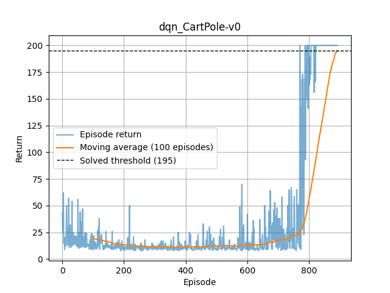
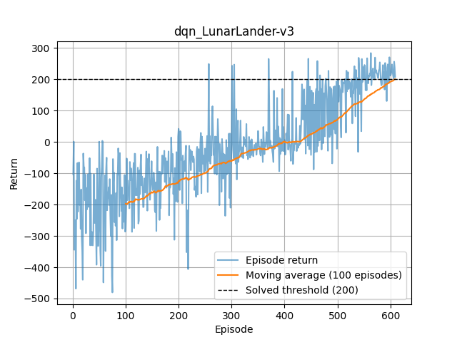

# Deep Q-Networks

A modular Deep Q-Network (DQN) with experience replay and a soft-updated target network, trained on CartPole (and LunarLander).

---

## Theory

Please note that the theory of Q-learning is hosted on this [page](https://parag1604.github.io/notes/Reinforcement-Learning/Q-Learning-and-SARSA); a dedicated DQN lecture is coming soon on https://parag1604.github.io/notes

## Python Environment Setup

Python >= 3.10, then:

```bash
pip install -r requirements.txt
```

`gymnasium[box2d]` is only needed for LunarLander (it needs `swig` to build; `brew install swig` on macOS). CartPole works with plain `gymnasium`.

## Data

No dataset is needed: the agent collects its own experience in [Gymnasium](https://gymnasium.farama.org/) environments.

## Running

Read the files in this order; each one is a single building block:

1. `q_network.py`: the MLP $Q_w(s,\cdot)$ with one output per action.
2. `replay_buffer.py`: stores transitions $(s, a, r, s', \text{terminated})$ and samples random mini-batches.
3. `agent.py`: $\epsilon$-greedy acting, and the regression of $Q_w(s,a)$ onto the TD target $r + \gamma\,(1-\text{terminated})\max_{a'} Q_{\text{target}}(s',a')$, with a soft target-network update.
4. `main.py`: the training loop.

```bash
python main.py                         # CartPole-v0
python main.py --env LunarLander-v3
python main.py --episodes 20           # quick run
```

Training stops when the average return of the last 100 episodes exceeds the environment's threshold (195 for CartPole-v0, 200 for LunarLander). The return curve (every episode's return, its 100-episode moving average and the threshold) is saved to `plots/dqn_<env>.png` and the network to `models/` (both git-ignored). Add `--render` to watch the greedy agent after training. The script prints "solved in N episodes" with N = (last episode - 100), the start of the winning 100-episode window.

## Results

Both runs use the default hyperparameters and seed (2022), on the CPU of an Apple-silicon Mac; re-running reproduces them exactly.

| Environment | Episodes run | Average of the last 100 | Wall-clock time |
|---|---|---|---|
| CartPole-v0 | 891 | 195.25 | 15 s |
| LunarLander-v3 | 609 | 200.26 | about 2 min |

CartPole-v0: the return stays around 10 to 25 for about 750 episodes and then shoots up to the 200 cap within a few dozen. The defaults (a slow soft update, $\tau = 10^{-3}$; one gradient step every 4 environment steps; $\epsilon$ decaying by 0.995 per episode) were tuned for LunarLander. CartPole's early episodes last only 10 to 20 steps, so in the first few hundred episodes the network gets only a few gradient steps per episode and the target network barely moves.



LunarLander-v3: a steady climb from about -200 to the 200 threshold.



A single-file version of the same algorithm, as the last step of a progression from dynamic programming through tabular Q-learning, is in the [RL-Basics](https://github.com/parag1604/RL-Basics) repository.
